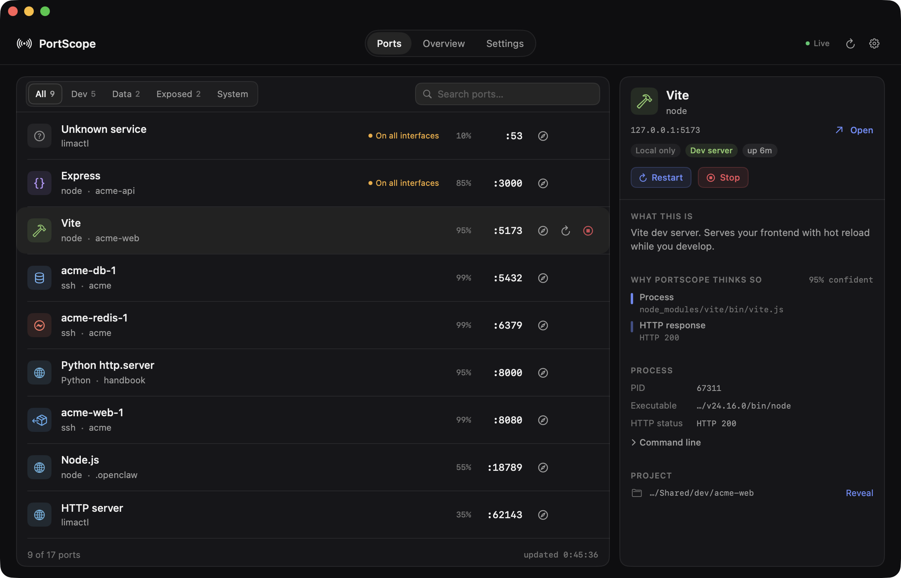

# PortScope

[简体中文](README.zh-CN.md) · English

A native macOS menu bar app that shows every port listening on your Mac,
explains what each service actually is, and lets you stop or restart it —
without hunting through `lsof`, `ps` and five terminal tabs.



## Install

Download the latest `PortScope-x.y.z.zip` from
[Releases](https://github.com/xiaoyuhen/portscope/releases), unzip, and drag
`PortScope.app` to Applications.

The build is **ad-hoc signed, not notarised**, so macOS blocks the first
launch. Either clear the quarantine flag once:

```bash
xattr -dr com.apple.quarantine /Applications/PortScope.app
```

or open it, dismiss the warning, and press **Open Anyway** in System Settings →
Privacy & Security. (On macOS 14, right-click → **Open** also works; macOS 15
removed that shortcut.)

Requires macOS 14 (Sonoma) or later. Apple silicon and Intel both work.

## Build from source

Xcode is **not** required — Apple's Command Line Tools are enough.

```bash
git clone https://github.com/xiaoyuhen/portscope.git
cd portscope
./scripts/build.sh
open dist/PortScope.app
```

`./scripts/package.sh` produces the same zip the releases ship: a universal
binary (Apple silicon and Intel) with a checksum, whose signature is verified
after extraction.

## Why

`lsof -iTCP -sTCP:LISTEN` tells you a PID owns port 5173. It does not tell you
that it is a Vite dev server for the project in `~/work/acme-web`, that it is
bound to every network interface, or that it has been running for three days.
PortScope answers those questions at a glance, and shows its reasoning.

## What it does

- **Every listening port, live.** Loopback, LAN and wildcard binds; IPv4 and
  IPv6 sockets of one service collapsed into a single row. Enumerating the
  sockets and reading process metadata takes about 100 ms; a first pass that
  also probes every candidate over HTTP takes about 2 s, and needs no elevated
  privileges.
- **Quiet by default.** Desktop apps and macOS services (WeChat, Discord,
  ControlCenter, `rapportd`) hold ports all day and are never what you open a
  monitor to look at. They fold into one row — "13 desktop and system ports" —
  that expands on click. Search still reaches them.
- **What it is, not just which PID.** Service, framework, project directory,
  HTTP status, and the evidence behind each conclusion. When it is unsure it
  says so — "Node.js, 55%" rather than a confident guess.
- **Docker containers by name.** A published port shows the container behind
  it — `acme-web-1`, image, Compose project — instead of `com.docker.backend`.
  Stop and Restart act on that one container through the engine API, never on
  Docker itself. Works with Docker Desktop, OrbStack, Colima and Rancher
  Desktop; no CLI needed.
- **Stop and restart.** Confirmed first, children included, verified after. See
  [Safety](#safety) for exactly what it will and will not touch.
- **A menu bar count.** Closing the window leaves PortScope running in the menu
  bar with a live port count; the panel lists the same rows as the window.
  **Open at login** is one switch in Settings.
- **English and 简体中文**, switchable at runtime. English is the default for
  everyone, whatever the system language is; 简体中文 applies once it is chosen
  in Settings.
- **Open in browser** or copy `localhost:port` from any row.

## Command line

The same engine, without the window — useful for scripts, and how the
compatibility suite drives it.

```bash
PortScope --list            # table of ports, processes and services
PortScope --list --json     # machine-readable
PortScope --stop 3000       # stop the service on :3000
PortScope --restart 3000    # stop it, then replay its command line
PortScope --selftest        # built-in checks, exit code 1 on failure
```

## How identification works

Three tiers of evidence, strongest first. They are merged rather than replaced:
a lower tier that *agrees* raises confidence, one that is merely present does
not.

| Tier | Signal | Example |
|---|---|---|
| 1. Process | executable, argv, cwd | `manage.py runserver` → Django, 95% |
| 2. HTTP | headers from a loopback-only `GET /` | `Server: AirTunes` → AirPlay receiver |
| 3. Port | well-known ports, last resort | 5173 → Vite, **capped at 50%** |

Confidence is capped at 99%: every signal here is inference. A port that
answers HTTP but matches nothing is reported as "HTTP API" at 35%, not as
"unknown" — that something is serving HTTP is already useful.

The probe is deliberately narrow: loopback only — `127.0.0.1`, or `::1` for a
service bound to IPv6 alone — never the LAN address, even for a service bound
to `0.0.0.0`. Redirects are never followed, 1 s timeout, fixed User-Agent, no
proxy, and skipped entirely for ports that cannot speak HTTP.

## How ports are folded

The rule is structural, not a list of app names, so installing a new app never
requires a code change:

1. A developer kind (dev server, bundler, database, cache, container, AI) →
   **show**.
2. A developer runtime (`node`, `python3.12`, `redis-server`, `docker`, …) →
   **show**.
3. A project directory is detectable → **show**.
4. The identifier called it a system service → **fold**.
5. It lives under `/System/`, `/usr/libexec/`, … → **fold**.
6. It lives in a `.app` bundle → **fold**.
7. Anything else → **show**.

The order is the design. Step 2 precedes step 5 so `python3 -m http.server` run
from `/usr/bin/python3` stays visible; it precedes step 6 so Docker's
`com.docker.backend` listener stays visible. Step 7 is the safe direction:
folding the one row someone is looking for is the expensive mistake.

## Safety

PortScope changes your machine, so the rules are enforced in code:

- **Never signals what it does not own** — only your own processes, never PID 1,
  never itself. Refusals are explained in the UI.
- **SIGTERM first**, SIGKILL only after a three-second grace period — and the UI
  says when force-kill was needed.
- **Takes the children.** A dev server owns its compiler, database and watcher;
  killing only the port owner leaves them holding the port.
- **Never reads your environment.** It is where API keys live, so a restart gets
  your shell's environment instead — noted in the confirmation dialog.
- **Verifies restarts.** The port must listen again within 20 s or the action is
  reported as failed. Output goes to `~/Library/Logs/PortScope/`.

## Privacy

Ports, processes, paths and command lines never leave the machine.

The one exception is an **anonymous launch count**: once per version per day,
the app sends its version, macOS major.minor, architecture and a random
per-install UUID. Never a port, process, path or hostname, and no IP address is
stored. It is on by default and switchable off in Settings.

The full payload, the receiver's storage format and every way to disable it are
in [docs/privacy.md](docs/privacy.md). A build from source sends nothing unless
you pass `PORTSCOPE_TELEMETRY_URL` explicitly.

## Validation

Three layers, because they catch different things.

```bash
PortScope --selftest              # logic checks, exit 1 on failure
./scripts/compat/fixtures.sh      # 4 real servers, identified and stopped
./scripts/validate.sh             # 20 UI checks against the running app
```

**Self-tests** cover the scanner, identifier, process control, folding rules,
the shared list model and localization. They are a hand-rolled harness because
neither XCTest nor Swift Testing is usable from Command Line Tools alone.

**The compatibility matrix** starts real servers — an Express-shaped HTTP
server, a framework-less Node server, Python's `http.server`, and one started
from a project directory — asks PortScope what each is, then stops each one
*through PortScope* and confirms the port is actually free. It needs nothing
outside the repo, which is what makes it runnable in CI.

**The UI harness** drives the built app through Accessibility the way a person
would: launches a scratch copy with an isolated preferences domain, opens the
menu bar panel, closes the window, presses "Open PortScope", and reads the
screen back. It fails if the panel and the window disagree about which ports
are folded, if the window does not reopen twice, if a fresh install is not in
English, or if a stored Chinese preference is not honoured.

CI runs the first two plus the bundle checks; the UI harness needs a GUI
session, so it runs locally. It is still compiled in CI so it cannot rot.

## Architecture

```
Sources/
  PortScopeKit/          # Engine, no UI. Reusable by a CLI or widget.
    Core/                # Scanner, process inspector, identifier, controller
    SelfTest/            # Built-in checks, run with --selftest
  PortScope/             # SwiftUI app
    App/                 # Entry point, store, menu bar, telemetry, CLI
    UI/                  # Design tokens and views
Support/Validation/      # UI harness driven by scripts/validate.sh
infra/telemetry/         # Cloudflare Worker that counts launches
```

No dependencies. The engine uses only the standard library and Darwin, which is
why the app is a few megabytes and builds with CLT alone.

### Toolchain notes

PortScope builds with Apple's Command Line Tools alone. Several SDK gaps are
worked around explicitly, and each is documented where it bites:

- `@State` / `@Environment` are macros whose plugin ships only with Xcode →
  `LocalState<Value>` (a one-property `ObservableObject`) for view-local state.
- Neither XCTest nor Swift Testing is usable from CLT → checks live in
  `PortScopeKit/SelfTest` and run via `--selftest`.
- `MenuBarExtra` and `NSPopover` do not present in this bundle configuration →
  `NSStatusItem` and a borderless `NSPanel`.
- SwiftUI `.sheet` never presents → in-window confirmation overlay.
- SwiftUI destroys its `WindowGroup` window on close → `MainWindowController`
  intercepts close and hides, so the menu bar item always has something to open.

## Contributing

Issues and pull requests are welcome. Read [CONTRIBUTING.md](CONTRIBUTING.md)
first — it lists the checks to run and the conventions the code follows.
Security reports go through [SECURITY.md](SECURITY.md), not public issues.

## Maintainer notes

Usage numbers come from two places, and neither needs a service to keep running:

- **Release downloads.** Every download of a release asset is counted by
  GitHub. `.github/workflows/usage-report.yml` posts a monthly snapshot to a
  rolling "Usage" issue.

  ```bash
  gh api repos/xiaoyuhen/portscope/releases/latest \
    --jq '.assets[] | "\(.name): \(.download_count)"'
  ```

- **Anonymous launch counts** from the app itself, when a receiver is
  configured. The worker is in [infra/telemetry](infra/telemetry/); deploying
  it is a one-time `wrangler deploy`, and the URL goes in the repository
  variable `PORTSCOPE_TELEMETRY_URL`. Until that variable is set, release
  builds send nothing.

## Milestones

| # | Milestone | Status |
|---|-----------|--------|
| M0 | Foundation: package layout, app bundle, build script, i18n, self-test | ✅ |
| M1 | Native port scanning (libproc) with process attribution | ✅ |
| M2 | Service identification: what each port is for | ✅ |
| M3 | Main window | ✅ |
| M4 | Stop and restart a service | ✅ |
| M5 | Menu bar app, language switch, settings | ✅ |
| M6 | Compatibility matrix, packaging, docs | ✅ |
| M7 | Menu bar parity, folding rule, default language, UI validation | ✅ |

Each landed as its own pull request; the write-ups are in `docs/milestones/`.

## The mark

A ring is the port; two pairs of arcs radiate from it. Designed against the
Bold Minimalism guidance in
[freshtechbro/claudedesignskills](https://github.com/freshtechbro/claudedesignskills).
Geometry and rationale in [docs/logo.md](docs/logo.md).

## License

MIT
